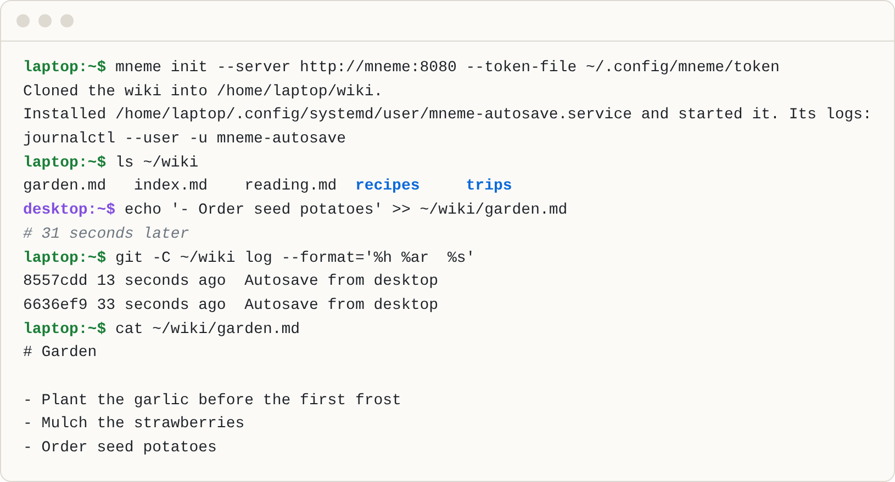

# Mneme

[](https://github.com/notes-supply/mneme/actions/workflows/ci.yml)
[](https://github.com/notes-supply/mneme/releases/latest)
[](#license)

Mneme is a Markdown wiki in Git, made for AI agents and the people who work with them. Agents and people edit plain files, and Mneme saves, syncs and serves them, so that a team keeps track of everything it knows: decisions, systems, runbooks and history.

<picture>
  <source media="(prefers-color-scheme: dark)" srcset="docs/images/terminal-dark.png">
  
</picture>

## Features

- **Just files.** Anyone or anything that can write a file can write the wiki.
- **Saved in seconds.** Each machine commits what has been still for 15 seconds, and pushes it.
- **No conflicts to resolve.** On the same lines the later edit wins, marked `Overlap:`, and history keeps the other.
- **Any Git remote.** A Git host over HTTPS, a bare repository by path, or a Mneme server.
- **A server that keeps the rules.** It checks every push, gives each machine a token, and shows each machine's state.
- **A reading API.** Pages, history, diffs and search as JSON, which [Atrium](https://github.com/notes-supply/atrium) shows to the whole team.
- **Signed releases.** Static Linux binaries and a non-root image, signed keyless by the workflows that built them.

## Getting started

Install `mneme` and `atrium` on Linux, x86_64 or aarch64, with Git 2.45 or newer:

```sh
curl -fsSL https://raw.githubusercontent.com/notes-supply/mneme/main/install.sh | sh
```

They go into `~/.local/bin`, which must be on your `PATH`; the installer says when it is not.

Make an empty repository on your Git host, and give each machine a token that can write to it alone, in `~/.config/mneme/token`. Then, on each machine:

```sh
mneme init --remote https://github.com/your-team/wiki.git --token-file ~/.config/mneme/token
systemctl --user enable --now atrium
```

`~/wiki` now syncs with every other machine, and http://localhost:8080 shows it. Without a systemd user manager, `mneme init --no-service` prints the service's command and `atrium --wiki-folder ~/wiki` runs in a terminal ([Install](docs/install.md#without-a-systemd-user-manager)). [Configuration](docs/configuration.md) has the other remotes.

> [!WARNING]
> A Mneme server's reading API, `/v1`, has no login: whoever reaches it reads the whole wiki. See [Deploy](docs/deploy.md#run-a-server) before you expose a server.

## Documentation

- [Install](docs/install.md): the installer, mise, verifying a download, and building from source.
- [Configuration](docs/configuration.md): remotes, `mneme init`, the service, how autosave behaves, and every option.
- [Deploy](docs/deploy.md): running a server, its image, releases, and Flux.
- [API](docs/api.md): the reading API.
- [Development](docs/development.md): the checks, the tests, and the screenshots.
- [Decisions](docs/decisions.md): why Mneme works the way it does.

## Contributing

See [CONTRIBUTING.md](CONTRIBUTING.md).

## Security

Report vulnerabilities privately, as [SECURITY.md](SECURITY.md) says.

## License

Licensed under either of the [Apache License, Version 2.0](LICENSE-APACHE) or the [MIT license](LICENSE-MIT), at your option.

Unless you explicitly state otherwise, any contribution intentionally submitted for inclusion in Mneme by you, as defined in the Apache-2.0 license, shall be dual licensed as above, without any additional terms or conditions.
