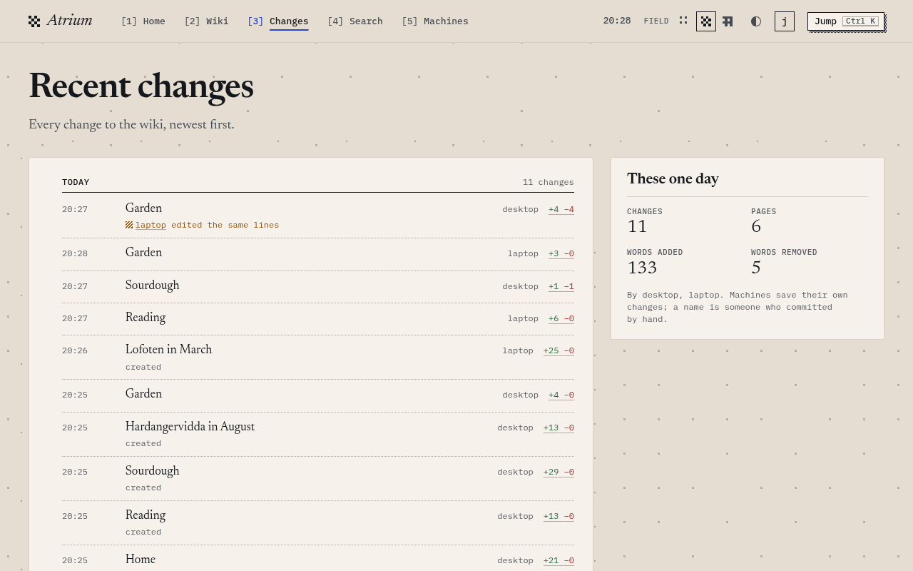

# Configuration

Every machine that writes the wiki runs the autosave service on its own folder, and every service syncs with the same remote. `mneme init` sets one up.

## mneme init

`mneme init` makes the folder ready, installs the service as a systemd user unit, and starts it. Run it once on each machine. With `--no-service`, or without `systemctl` on `PATH`, it prints the command that runs the service instead; pass `--no-service` where `systemctl --user` finds no user manager, as over SSH.

- A missing or empty folder gets a clone. A folder of notes that is not a Git repository becomes the wiki when the remote is empty, and the first save pushes the notes.
- The unit runs `mneme autosave run` with absolute paths, and its logs are in `journalctl --user -u mneme-autosave`.
- Running it again with the same options leaves the unit as it is. A different unit is refused unless `--force`.

| Option | |
|---|---|
| `--remote URL` | A Git remote: a Git host's `https://` URL, or a path or `file://` URL on this machine. |
| `--server URL` | A Mneme server's base URL, such as `https://mneme.example`. |
| `--token-file FILE` | A file that holds this machine's token and nothing else. A server needs one; a Git host over HTTPS usually does. |
| `--folder DIR` | The wiki folder. `~/wiki` by default. |
| `--name NAME` | This machine's name, on every commit it makes and in a server's tokens file. The short host name by default. |
| `--no-service` | Make the folder ready and print the command that runs the service, instead of installing a unit. |
| `--force` | Replace an installed unit that differs. |

## Remotes

Exactly one of `--remote` and `--server`.

**A Git host over HTTPS.** Make an empty private repository. Give each machine an access token that can read and write that repository's contents and nothing else, such as a fine-grained token on GitHub scoped to the one repository, in a file only that machine's user can read:

```sh
mneme init --remote https://github.com/your-team/wiki.git --token-file ~/.config/mneme/token
```

The token is sent as the password of HTTP Basic authentication, to that URL alone, and is never written to Git's configuration or a log. A host that wants the token's user name takes it in the URL, as `https://name@host/wiki.git`. A URL that holds a password is refused.

**A Mneme server.** The server's tokens file names this machine as `--name` does, and the token file holds its token ([deploy.md](deploy.md) runs a server):

```sh
mneme init --server https://mneme.example --token-file ~/.config/mneme/token
```

**A path**, such as a bare repository on the same machine:

```sh
git init --bare -b main ~/wiki.git
mneme init --remote ~/wiki.git
```

`--remote` takes these and nothing else, and plain `http://` only to `localhost`, `127.0.0.1` or `[::1]`, since the token and the wiki would cross the network in clear text. Any other remote is refused with a message that says what Mneme syncs with.

## Reading the wiki

<picture>
  <source media="(prefers-color-scheme: dark)" srcset="images/changes-dark.png">
  
</picture>

[Atrium](https://github.com/notes-supply/atrium) shows the wiki in `~/wiki` at http://localhost:8080. The installer puts its unit in place when it installs into `~/.local/bin` on a machine with `systemctl`; start it with `systemctl --user enable --now atrium`. Otherwise run `atrium --wiki-folder ~/wiki`.

Atrium reads the folder through `mneme serve --folder ~/wiki`, which serves the [reading API](api.md) of a clone: pages, history, diffs and search. It listens on loopback only, `127.0.0.1:8081` by default, answers only requests addressed to `localhost`, `127.0.0.1` or `[::1]`, writes nothing, and follows the folder's `main` as the service syncs.

## The service

`mneme init` writes the service's command into its unit. `mneme autosave init`, with the same remote options, clones into a missing or empty folder or checks an existing clone, and `mneme autosave run` is the service:

```sh
mneme autosave run --folder ~/wiki --server https://mneme.example --token-file ~/.config/mneme/token --name laptop
```

| Option of `run` | Default | |
|---|---|---|
| `--tick-seconds` | 5 | Seconds between ticks. |
| `--quiet-seconds` | 15 | Seconds every changed file must have been still before a save. |
| `--fetch-seconds` | 30 | Seconds between fetches when nothing else asks for one. |
| `--report-seconds` | 300 | Seconds between reports to a server of a state that has not changed. |
| `--stale-lock` | 300 | Seconds `.git/index.lock` may sit unchanged before it counts as a dead command's and is removed. |

A folder takes one service: a second `run` on it exits. The service logs JSON lines on standard error and stops on SIGTERM.

## How autosave behaves

- A change is saved once every changed file has been still for 15 seconds, then pushed. The service fetches right after, and every 30 seconds.
- When two machines change the same lines, the later one keeps its own text and marks its commit with an `Overlap:` trailer. The other text stays in the history.
- It waits while the folder is in the middle of a Git operation it did not start, and stops saving when a save would delete most pages.
- A file the server would refuse, such as a symlink, a page over 1 MiB or any file over 10 MiB, stays in the folder and out of every save, and the service reports it.
- Git runs without the machine's own Git configuration, so ignores belong in the wiki's `.gitignore`.
- It never waits for a person: Git may not prompt, and a wrong token fails at once.

A plain remote stores what it is sent. It has no push check, so a commit made by hand that holds such a file gets in, and no `/v1/machines`, so a machine's log is the only place that says it is stuck.

## mneme serve

| Option | |
|---|---|
| `--repo DIR` | The wiki's bare repository, created when it is missing. A server: Git over `/git/wiki.git`, the push check, machine state and the reading API. |
| `--tokens FILE` | With `--repo`: a JSON object that maps each machine's name to the SHA-256 of its token. |
| `--folder DIR` | Instead of `--repo`: only the reading API of a clone on this machine, on loopback. |
| `--addr ADDR` | Where to listen. `127.0.0.1:8080` with `--repo`, `127.0.0.1:8081` with `--folder`. |

[deploy.md](deploy.md) runs a server, and says what to expose.
